# 2×2 SRAM Full-Custom Design — MoaFab MyChip

> 모아팹(MoaFab) **'내 칩(MyChip)'** 서비스를 통해 설계·제작한 **2×2 6T SRAM** 풀커스텀 설계 프로젝트입니다.
> 회로 설계부터 레이아웃, DRC/LVS 검증, 패드 포함 Top-level 시뮬레이션까지 진행했으며, 제작된 칩은 Zynq-7000 FPGA 기반으로 실리콘 검증할 예정입니다.


<p align="center">
  
</p>

---

## 📌 목차

1. [프로젝트 개요](#-프로젝트-개요)
2. [설계 사양](#-설계-사양)
3. [아키텍처](#-아키텍처)
4. [회로 설계 (Schematic)](#-회로-설계-schematic)
5. [레이아웃 (Layout)](#-레이아웃-layout)
6. [시뮬레이션 결과](#-시뮬레이션-결과)
7. [물리 검증 (DRC / LVS)](#-물리-검증-drc--lvs)
8. [핀 배치](#-핀-배치)
9. [실리콘 검증 계획](#-실리콘-검증-계획)
10. [팀](#-팀)

---

## 🧭 프로젝트 개요

| 항목 | 내용 |
|---|---|
| 프로그램 | 과학기술정보통신부 반도체설계검증인프라활성화사업 — MoaFab 'MyChip' |
| 형태 | 한성대학교 학부연구생 칩 설계 프로젝트 |
| 설계 대상 | 2×2 SRAM (Top Cell: `SRAM`) |
| 설계 방식 | Full-custom (Schematic → Layout → DRC/LVS) |
| 사용 소자 | NMOS, PMOS |

**목표**

1. **Silicon Validation** — 실제 공정으로 제작된 칩이 설계 의도대로 Read / Write / 초기 상태 유지 동작을 수행하는지 물리적으로 확인
2. **Sim vs. Measurement** — EDA 시뮬레이션 예측치(Delay, Power, SNM)와 실측값을 비교해 기생 성분(Parasitics) 및 PVT 변동의 영향 분석

---

## 📐 설계 사양

| 항목 | 값 |
|---|---|
| 구성 | 2 × 2 (4-bit), 6T SRAM Cell |
| 동작 전압 | 5.0 V (Full-swing 0 ~ 5 V) |
| 동작 주기 / 주파수 | 약 40 ns / 최대 약 25 MHz |
| 제어 신호 펄스 폭 (WL, WE, SE) | 약 17 ~ 20 ns |
| Write Access Delay | 약 1 ~ 2 ns (WE/WL 활성화 기준, 시뮬레이션) |
| Read Access Delay | < 1 ns (SE 활성화 기준, 시뮬레이션) |
| 설계 면적 | Top_sram 248.2 µm × 268.4 µm / 테스트 Inverter 13.8 µm × 29.6 µm |
| 패키지 | MPW_PAD_28pin 표준칩 배치, Bare Die & 28-pin SOP |

**6T SRAM Cell 트랜지스터 사이즈** (L = 0.6 µm)

| 트랜지스터 | 역할 | W |
|---|---|---|
| M0, M1 (NMOS) | Pull-down | 3.6 µm |
| M4, M5 (PMOS) | Pull-up | 3.6 µm |
| M2, M3 (NMOS) | Access (Pass-gate) | 1.8 µm |

> Cell Ratio (Pull-down / Access) = 2 → Read 시 셀 데이터 안정성 확보

---

## 🏗 아키텍처

```
                 ┌─────────────┐
   RIN, REN ───▶ │ Row Decoder │──▶ WL0, WL1
                 └─────────────┘
                        │
     PRE ───▶ ┌──────────────────┐
              │ Precharge_double │
              └──────────────────┘
                        │  BL0/BLB0, BL1/BLB1
              ┌──────────────────┐
              │  SRAM_2x2 (6T×4) │
              └──────────────────┘
                        │
              ┌──────────────────┐
     CA ────▶ │   Column MUX     │
              └──────────────────┘
                        │  BL / BLB
        ┌───────────────┴───────────────┐
 DATA,WE ▶ WR_Drive                SE ▶ Senseamp ──▶ OUTS
        └──── Combined_mux_sa_wrd ──────┘
```

| 블록 | 설명 |
|---|---|
| `Inverter`, `NAND` | 디코더 구성용 기본 게이트 |
| `Row_Decoder` | Row 주소(RIN)와 Enable(REN)로 Word Line 선택 |
| `Precharge` / `Precharge_double` | 읽기 전 Bit Line 쌍을 VDD로 프리차지 (2열용) |
| `SRAM_cell` | Cross-coupled Inverter + Access Tr. 6T 셀 |
| `SRAM_2x2` | 6T 셀 4개 어레이 |
| `MUX` | Column 선택 (Y0 / Y0B) |
| `WR_Drive` | WE 활성 시 DATA를 BL/BLB에 구동 |
| `Senseamp` | SE 활성 시 BL/BLB 전압차 증폭 → 출력 |
| `Combined_mux_sa_wrd` | MUX + Sense Amp + Write Driver 통합 블록 |
| `Top_sram` | 전체 SRAM 코어 |

---

## 🔌 회로 설계 (Schematic)

### 전체 회로도
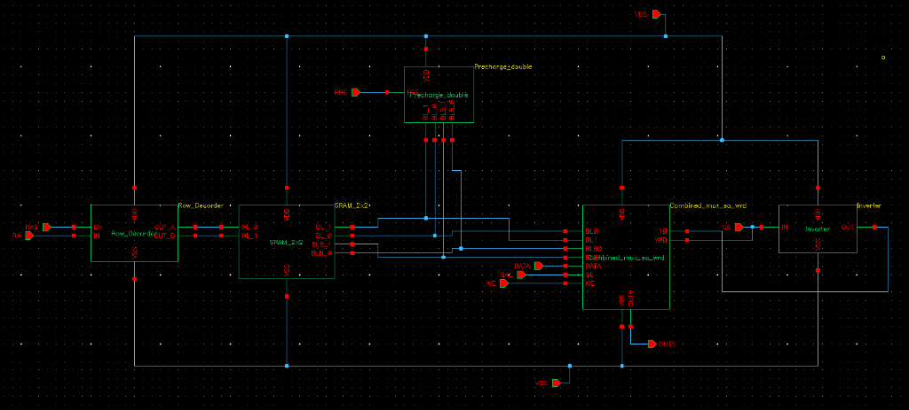

### 블록별 회로도

| Inverter | NAND |
|:---:|:---:|
|  |  |

| Row Decoder |
|:---:|
|  |

| Precharge | Precharge_double |
|:---:|:---:|
| 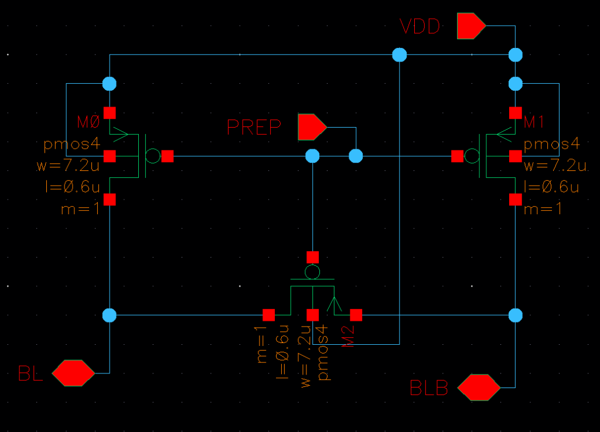 | 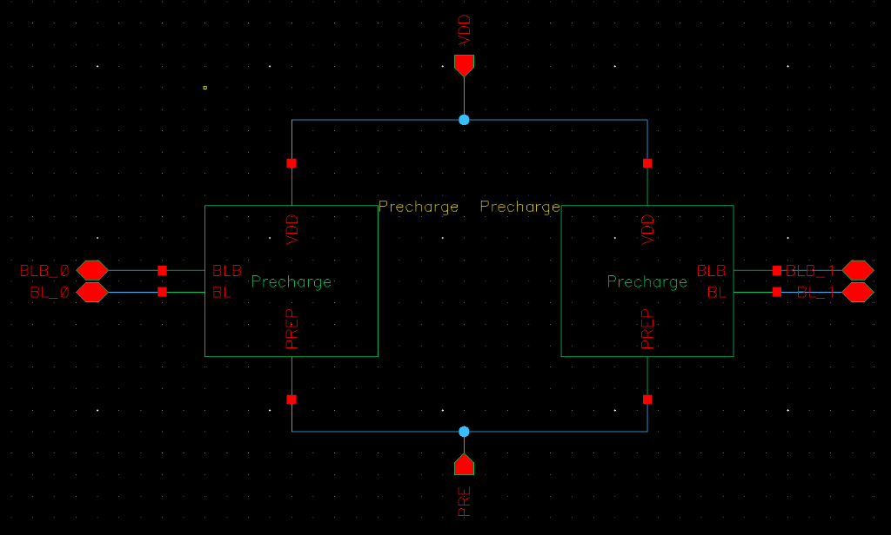 |

| Sense Amplifier | Write Driver |
|:---:|:---:|
|  |  |

| Column MUX | MUX + SA + WR Driver |
|:---:|:---:|
| 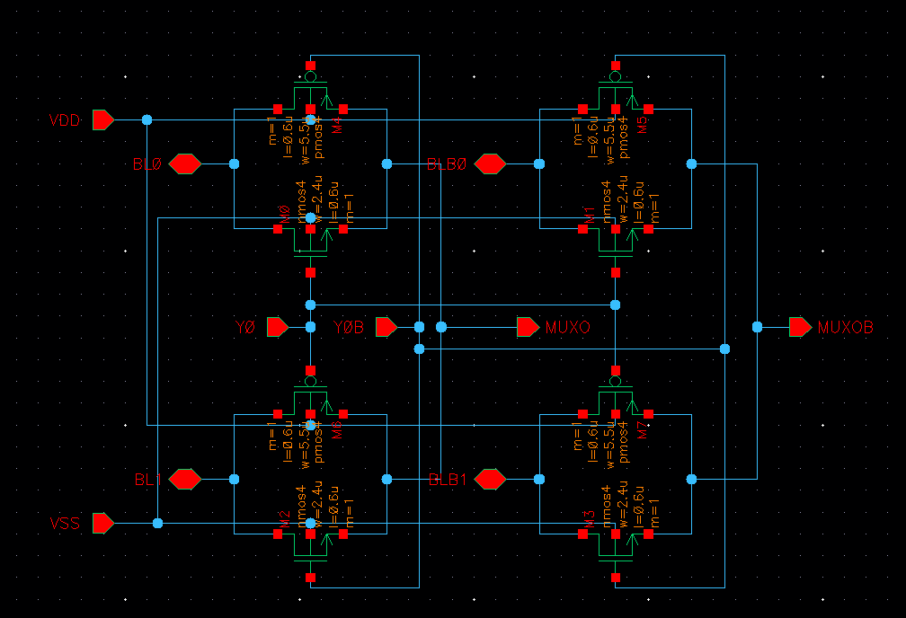 | 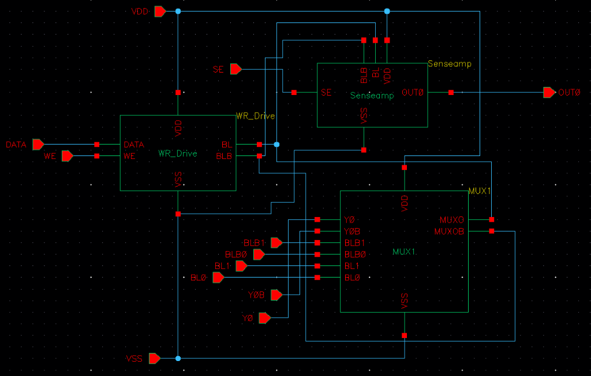 |

| 6T SRAM Cell | SRAM 2×2 Array |
|:---:|:---:|
| 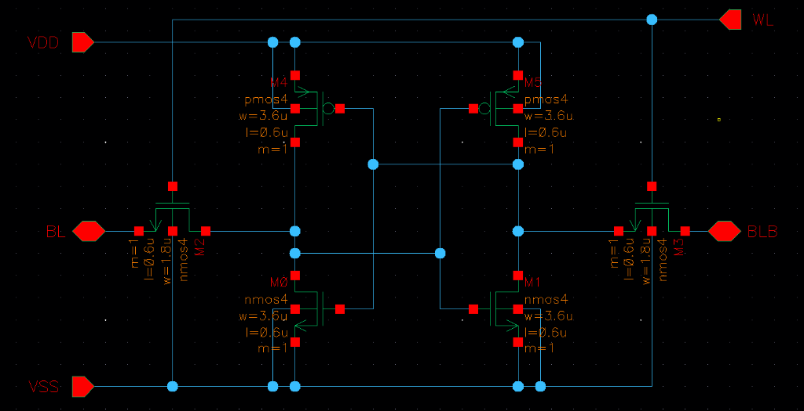 | 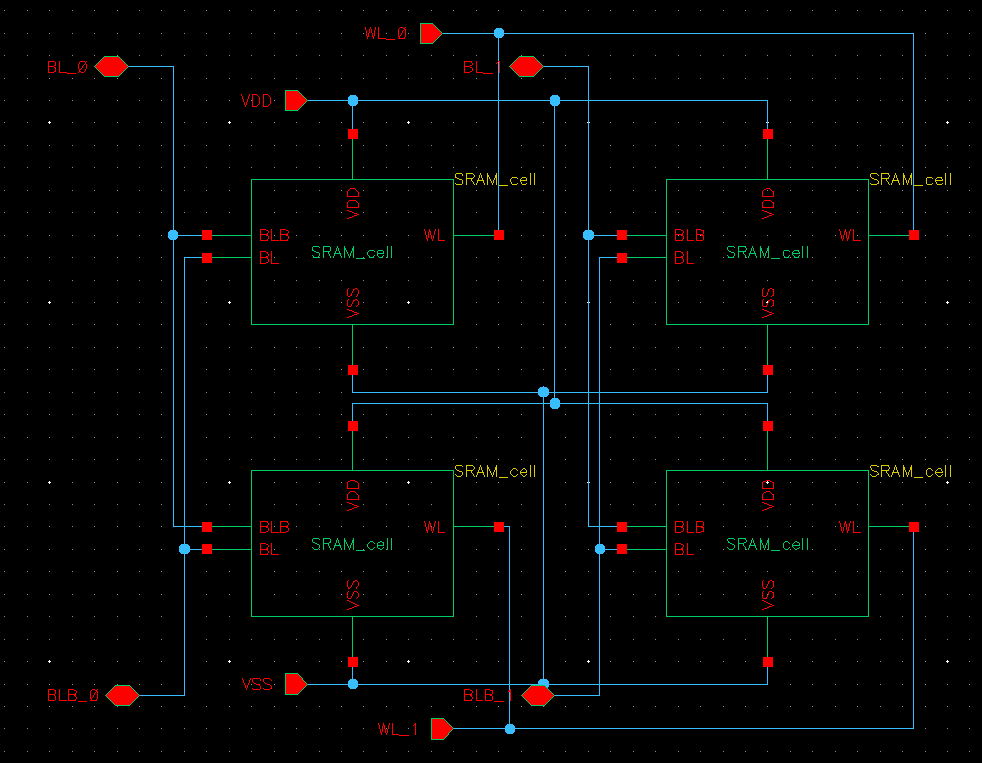 |

---

## 🧱 레이아웃 (Layout)

### 전체 레이아웃
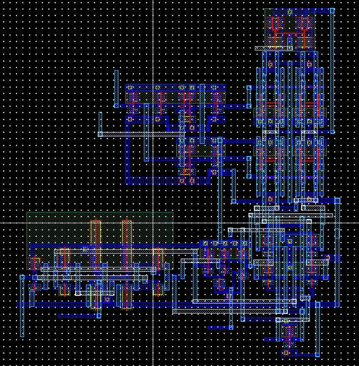

### 블록별 레이아웃

| Inverter | NAND | Row Decoder |
|:---:|:---:|:---:|
| 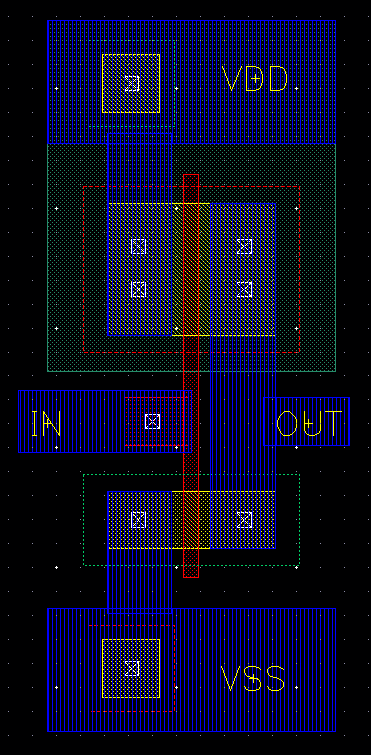 |  |  |

| Precharge_double | Sense Amplifier | Column MUX |
|:---:|:---:|:---:|
| 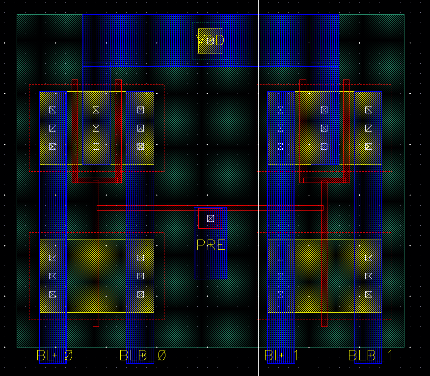 | 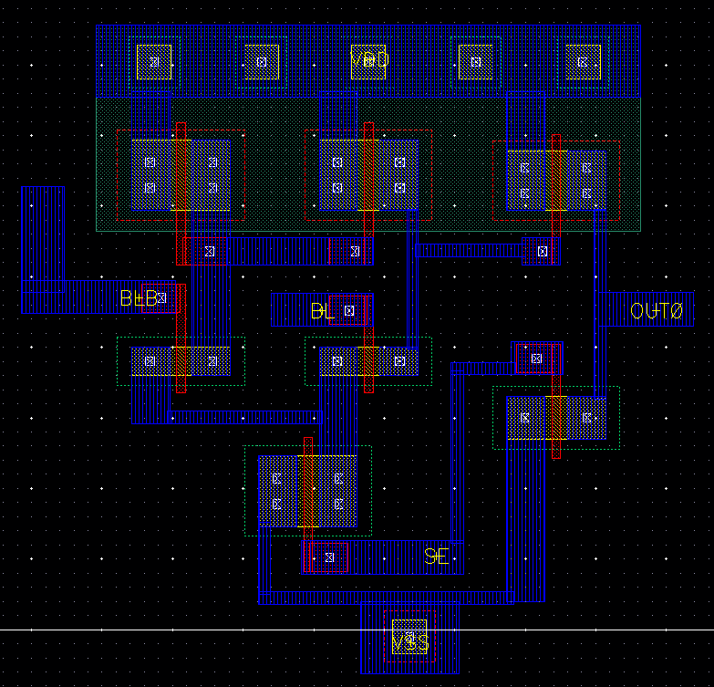 |  |

| Write Driver | 6T SRAM Cell | SRAM 2×2 Array |
|:---:|:---:|:---:|
| 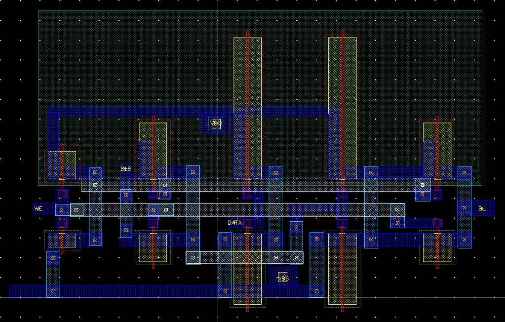 |  | 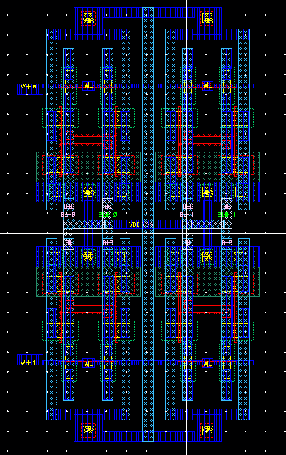 |

---

## 📈 시뮬레이션 결과

Cadence Virtuoso ADE XL / Maestro 환경에서 Transient 시뮬레이션을 수행했습니다.

### 패드(I/O) 포함 Top-level Testbench
PIC(입력 패드), POB4(출력 패드)를 포함한 칩 레벨 테스트벤치입니다.

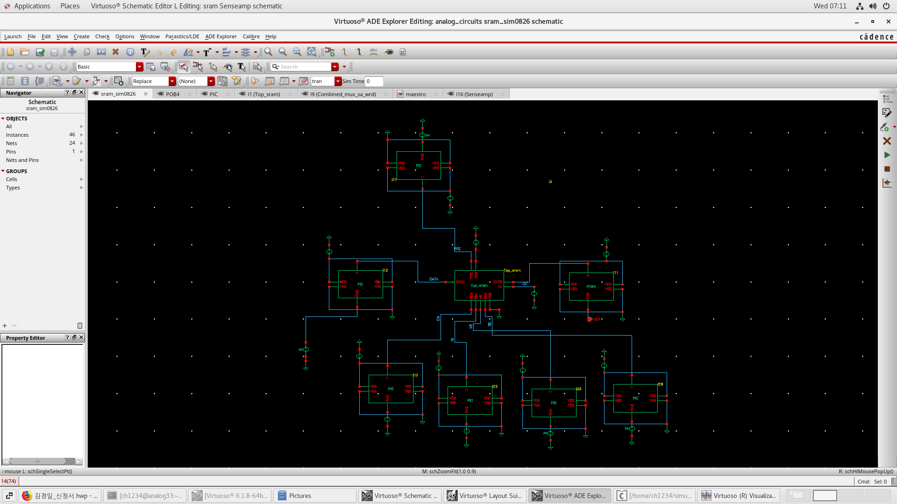

### Transient Response (0 ~ 40 ns)


**관찰 결과**

- **Write** — DATA 토글(0 → 1 → 0)에 맞춰 내부 노드 `q` / `qb`가 반전되며, WE·WL 활성화 후 약 1 ~ 2 ns 내에 완전한 논리 레벨(0 V / 5 V)로 안착
- **Read** — Precharge 해제 후 SE 활성화 시 `OUT`이 1 ns 미만으로 응답
- **Stability** — 읽기 중 비트라인 커플링·전하 분배에 의한 Read Disturb 없이 `q` / `qb` 상태 유지

---

## ✅ 물리 검증 (DRC / LVS)

Siemens **Calibre 2023.3**으로 검증했습니다.

| DRC | LVS |
|:---:|:---:|
| 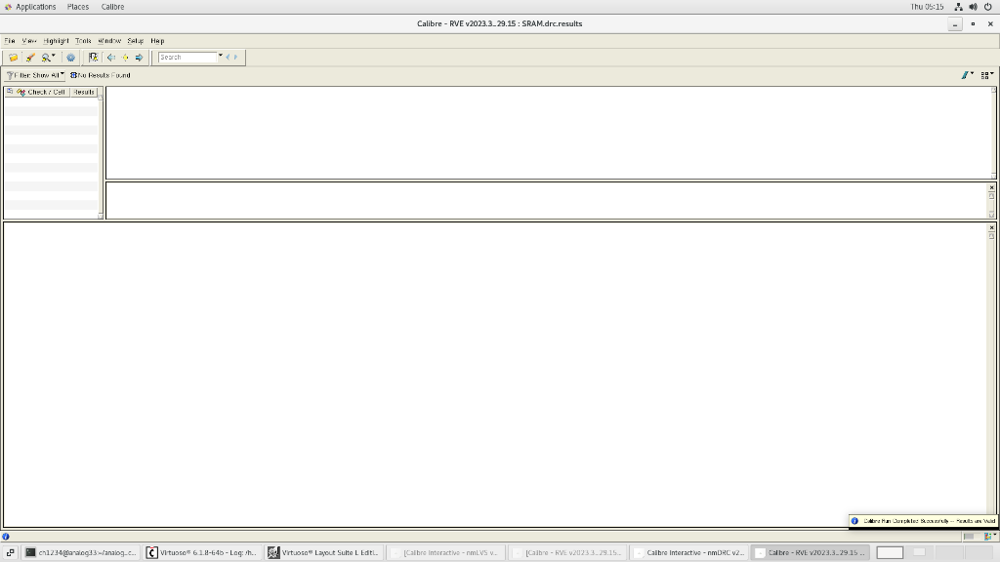 |  |
| DRC Clean | **CORRECT** — Layout/Source 인스턴스 130 / 130 일치 |

---

## 📍 핀 배치

28-pin SOP 패키지 (MPW_PAD_28pin 표준 배치)

| 신호 | 핀 | 설명 | | 신호 | 핀 | 설명 |
|---|:---:|---|---|---|:---:|---|
| OUT | 5 | 테스트 Inverter 출력 | | RIN | 18 | Row 주소 입력 |
| PRE | 6 | Precharge 제어 | | WE | 19 | Write Enable |
| IN | 11 | 테스트 Inverter 입력 | | SAE | 20 | Sense Amp Enable |
| DATA | 12 | 쓰기 데이터 입력 | | CA | 24 | Column 주소 입력 |
| VDD | 14 | 전원 | | OUTS | 26 | SRAM 데이터 출력 |
| REN | 15 | Row Decoder Enable | | VSS | 28 | 접지 |

---

## 🔬 실리콘 검증 계획

제작된 칩을 Breakout Board를 통해 **AMD Zynq-7000 SoC** 보드에 연결하고, FPGA BRAM 기반 레퍼런스 SRAM과 동작을 비교합니다.

```
 PC ──UART──▶ Zynq PS (ARM Cortex-A9, Vitis)
                    │ AMBA (AXI)
                    ▼
             Zynq PL (Verilog, Vivado)
             ├─ Reference SRAM (BRAM)
             └─ Test Sequencer ──▶ Breakout Board ──▶ Silicon SRAM Chip
                                                         │
                                               Oscilloscope (SAE / OUTS)
```

| 단계 | 검증 항목 | 판정 기준 |
|:---:|---|---|
| 0 | 테스트 Inverter | 패키징 및 기본 공정 건전성 확인 |
| 1 | Precharge 회로 | DATA '1' 기록 → PRE High → PRE Low 후 연속 Read 시 비트라인 전압 유지 여부 (구동력 부족·누설 전류 판별) |
| 2 | Row Decoder / Column MUX | 특정 주소 전체 R/W 불가 → 소자 결함, 다중 주소 활성화 → Double Selection 결함 |
| 3 | Write Driver | 4개 셀 전체 '1' / '0' 쓰기 후 읽기 → 쓰기 시에만 오류 시 드라이버 구동력 결함 |
| 4 | Read 타이밍 | 오실로스코프로 SAE → OUTS 지연(Read Access Time), Slew Rate, 펄스 응답 측정 |

---

## 🛠 개발 환경

| 용도 | Tool |
|---|---|
| Schematic / Simulation | Cadence Virtuoso 6.1.8 (ADE Explorer, ADE XL / Maestro) |
| Layout | Cadence Virtuoso Layout Suite 6.1.8 |
| DRC / LVS | Siemens Calibre 2023.3 |
| 실리콘 검증 (예정) | AMD Vivado, Vitis, Zynq-7000 |

---

## 📁 저장소 구조

```
sram-2x2-mychip/
├── README.md
└── docs/
    └── images/
        ├── schematic/      # 블록별 회로도
        ├── layout/         # 블록별 레이아웃 + 패드 포함 칩
        ├── simulation/     # Testbench, Transient 파형
        └── verification/   # DRC / LVS 결과
```

---

## 👥 팀

한성대학교 학부연구생 칩 설계 프로젝트

| 이름 | 소속 |
|---|---|
| 홍원기 | 한성대학교 시스템반도체 |
| 김경일 | 한성대학교 전자 |
| 이종복 교수 | 지도교수 |

## 🙏 Acknowledgement

본 프로젝트는 과학기술정보통신부 **반도체설계검증인프라활성화사업** (No. RS-2023-00258732)의 지원과 모아팹(MoaFab) 'MyChip' 서비스를 통해 수행되었습니다.
