# 2×2 SRAM Full-Custom Design — MoaFab MyChip

> 모아팹(MoaFab) **'내 칩(MyChip)'** 서비스를 통해 설계·제작한 **2×2 6T SRAM** 풀커스텀 설계 프로젝트입니다.
> 회로 설계부터 레이아웃, DRC/LVS 검증, 패드 포함 Top-level 시뮬레이션과 성능 측정(Delay · Energy · Power)까지 진행했으며, 제작된 칩은 Zynq-7000 FPGA 기반으로 실리콘 검증할 예정입니다.


<p align="center">
  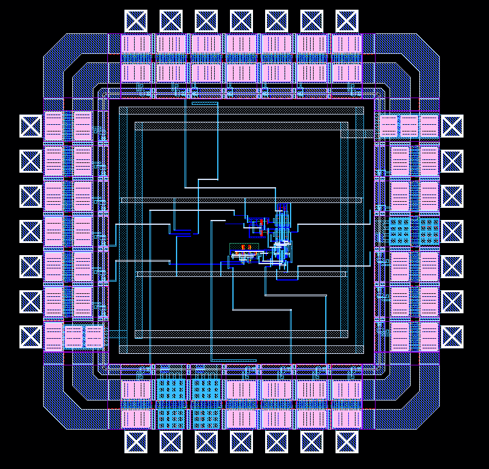
</p>

---

## 📌 목차

1. [프로젝트 개요](#-프로젝트-개요)
2. [설계 사양](#-설계-사양)
3. [아키텍처](#-아키텍처)
4. [회로 설계 (Schematic)](#-회로-설계-schematic)
5. [레이아웃 (Layout)](#-레이아웃-layout)
6. [시뮬레이션 결과](#-시뮬레이션-결과)
7. [성능 측정 (Simulation)](#-성능-측정-simulation)
8. [물리 검증 (DRC / LVS)](#-물리-검증-drc--lvs)
9. [핀 배치](#-핀-배치)
10. [실리콘 검증 계획](#-실리콘-검증-계획)
11. [개발 환경](#-개발-환경)
12. [저장소 구조](#-저장소-구조)
13. [팀](#-팀)

---

## 🧭 프로젝트 개요

| 항목 | 내용 |
|---|---|
| 프로그램 | 과학기술정보통신부 반도체설계검증인프라활성화사업 — MoaFab 'MyChip' |
| 형태 | 한성대학교 학부연구생 칩 설계 프로젝트 |
| 설계 대상 | 2×2 SRAM (Top Cell: `SRAM`) |
| 설계 방식 | Full-custom (Schematic → Layout → DRC/LVS) |
| 사용 소자 | NMOS, PMOS |

**목표**

1. **Silicon Validation** — 실제 공정으로 제작된 칩이 설계 의도대로 Read / Write / 초기 상태 유지 동작을 수행하는지 물리적으로 확인
2. **Sim vs. Measurement** — EDA 시뮬레이션 예측치(Delay, Power, SNM)와 실측값을 비교해 기생 성분(Parasitics) 및 PVT 변동의 영향 분석

---

## 📐 설계 사양

| 항목 | 값 |
|---|---|
| 구성 | 2 × 2 (4-bit), 6T SRAM Cell |
| 동작 전압 | 5.0 V (Full-swing 0 ~ 5 V) |
| 동작 주기 / 주파수 | 5 ns / 200 MHz (시뮬레이션 조건, 5 ns마다 Write 또는 Read 1회) |
| 제어 신호 펄스 폭 (WL, WE, SE) | 약 2.4 ns (50% 기준, 시뮬레이션 조건) |
| Write Access Delay | 1.262 ns (WL 50% → 셀 노드 `q` 50%, Worst-case, 시뮬레이션) |
| Read Access Delay | 2.829 ns (WL 50% → `OUT` 50%, Worst-case, 시뮬레이션) |
| 평균 전력 / 누설 전력 | 5.795 mW / 632.8 pW (시뮬레이션, [성능 측정](#-성능-측정-simulation) 참고) |
| 설계 면적 | Top_sram 248.2 µm × 268.4 µm / 테스트 Inverter 13.8 µm × 29.6 µm |
| 패키지 | MPW_PAD_28pin 표준칩 배치, Bare Die & 28-pin SOP |

**6T SRAM Cell 트랜지스터 사이즈** (L = 0.6 µm)

| 트랜지스터 | 역할 | W |
|---|---|---|
| M0, M1 (NMOS) | Pull-down | 3.6 µm |
| M4, M5 (PMOS) | Pull-up | 3.6 µm |
| M2, M3 (NMOS) | Access (Pass-gate) | 1.8 µm |

> Cell Ratio (Pull-down / Access) = 2 → Read 시 셀 데이터 안정성 확보

---

## 🏗 아키텍처

```
                 ┌─────────────┐
   RIN, REN ───▶ │ Row Decoder │──▶ WL0, WL1
                 └─────────────┘
                        │
     PRE ───▶ ┌──────────────────┐
              │ Precharge_double │
              └──────────────────┘
                        │  BL0/BLB0, BL1/BLB1
              ┌──────────────────┐
              │  SRAM_2x2 (6T×4) │
              └──────────────────┘
                        │
              ┌──────────────────┐
     CA ────▶ │   Column MUX     │
              └──────────────────┘
                        │  BL / BLB
        ┌───────────────┴───────────────┐
 DATA,WE ▶ WR_Drive                SE ▶ Senseamp ──▶ OUTS
        └──── Combined_mux_sa_wrd ──────┘
```

| 블록 | 설명 |
|---|---|
| `Inverter`, `NAND` | 디코더 구성용 기본 게이트 |
| `Row_Decoder` | Row 주소(RIN)와 Enable(REN)로 Word Line 선택 |
| `Precharge` / `Precharge_double` | 읽기 전 Bit Line 쌍을 VDD로 프리차지 (2열용) |
| `SRAM_cell` | Cross-coupled Inverter + Access Tr. 6T 셀 |
| `SRAM_2x2` | 6T 셀 4개 어레이 |
| `MUX` | Column 선택 (Y0 / Y0B) |
| `WR_Drive` | WE 활성 시 DATA를 BL/BLB에 구동 |
| `Senseamp` | SE 활성 시 BL/BLB 전압차 증폭 → 출력 |
| `Combined_mux_sa_wrd` | MUX + Sense Amp + Write Driver 통합 블록 |
| `Top_sram` | 전체 SRAM 코어 |

---

## 🔌 회로 설계 (Schematic)

### 전체 회로도


### 블록별 회로도

| Inverter | NAND |
|:---:|:---:|
| 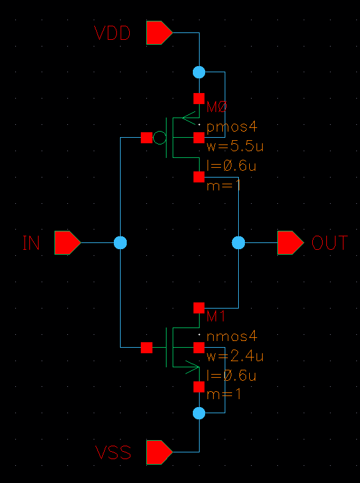 | 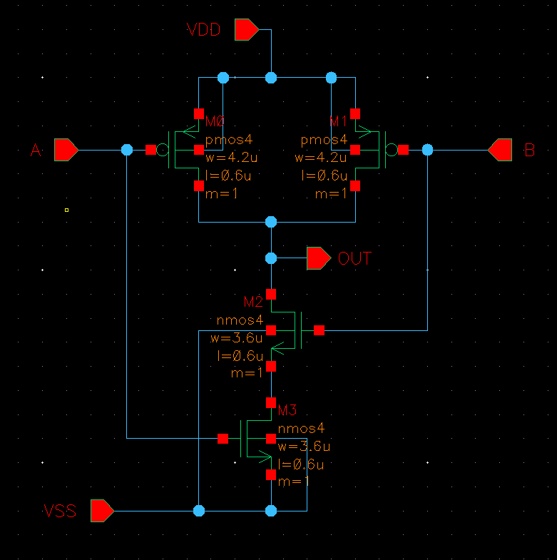 |

| Row Decoder |
|:---:|
| 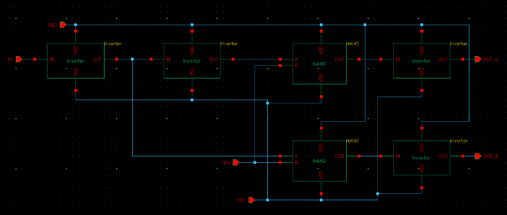 |

| Precharge | Precharge_double |
|:---:|:---:|
|  |  |

| Sense Amplifier | Write Driver |
|:---:|:---:|
| 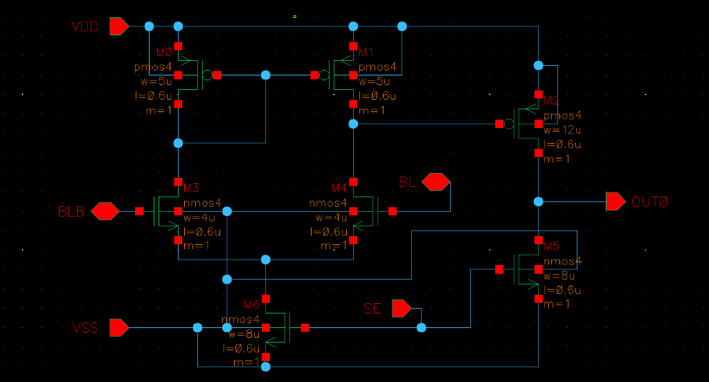 | 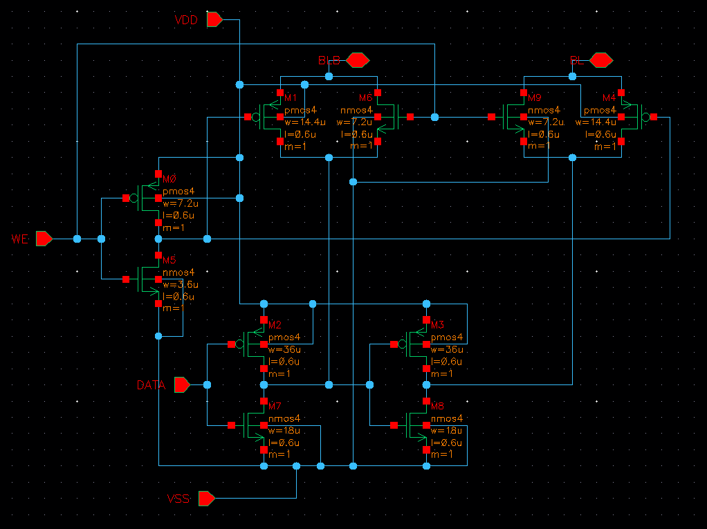 |

| Column MUX | MUX + SA + WR Driver |
|:---:|:---:|
|  |  |

| 6T SRAM Cell | SRAM 2×2 Array |
|:---:|:---:|
|  |  |

---

## 🧱 레이아웃 (Layout)

### 전체 레이아웃


### 블록별 레이아웃

| Inverter | NAND | Row Decoder |
|:---:|:---:|:---:|
|  | 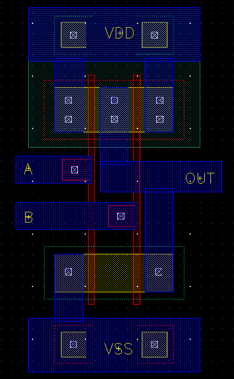 | 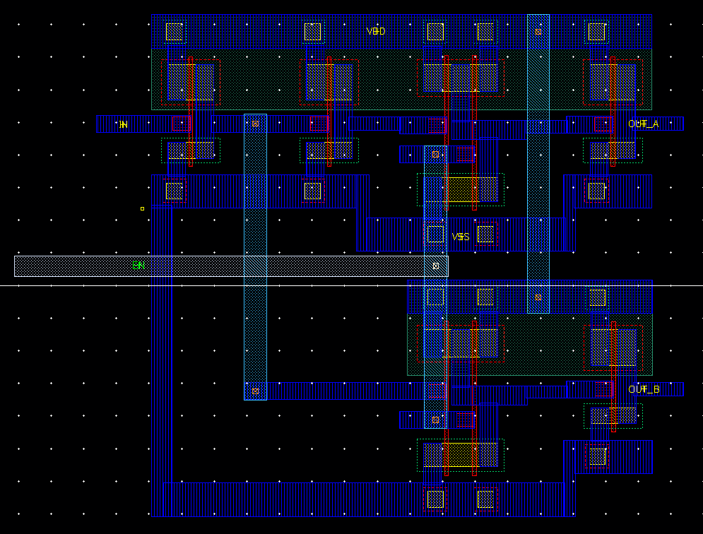 |

| Precharge_double | Sense Amplifier | Column MUX |
|:---:|:---:|:---:|
|  |  | 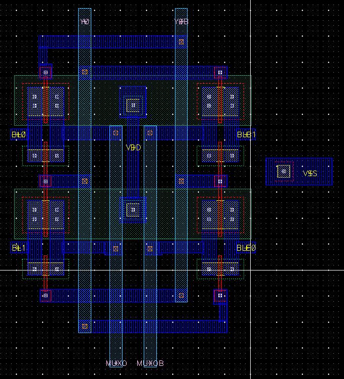 |

| Write Driver | 6T SRAM Cell | SRAM 2×2 Array |
|:---:|:---:|:---:|
|  | 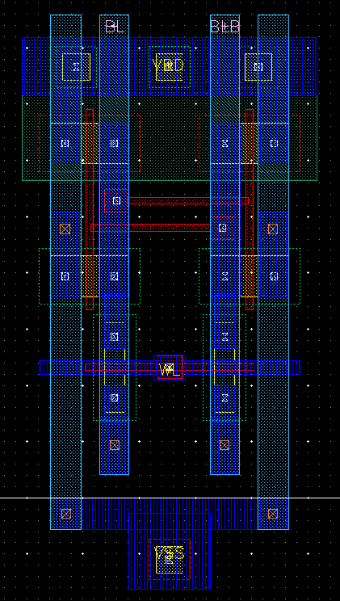 |  |

---

## 📈 시뮬레이션 결과

Cadence Virtuoso ADE XL / Maestro 환경에서 Transient 시뮬레이션을 수행했습니다.

### 패드(I/O) 포함 Top-level Testbench
PIC(입력 패드), POB4(출력 패드)를 포함한 칩 레벨 테스트벤치입니다.


### Transient Response — Cell A (0 ~ 40 ns)

IN = 1, CA = 0으로 고정해 Cell A(`I0`) 한 개를 동작시킨 파형입니다. 4개 셀 순차 동작과 정량 측정은 [성능 측정](#-성능-측정-simulation)을 참고하세요.

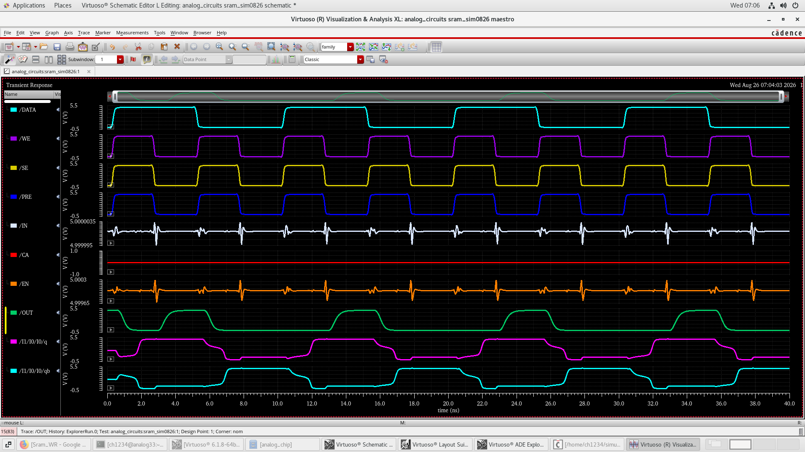

**관찰 결과**

- **Write** — DATA 토글(0 → 1 → 0)에 맞춰 내부 노드 `q` / `qb`가 반전되며, WE·WL 활성화 후 약 1 ~ 2 ns 내에 완전한 논리 레벨(0 V / 5 V)로 안착 (50% 기준 Write Delay 측정값 1.262 ns)
- **Read** — Precharge 해제 후 SE 활성화 시 `OUT`으로 데이터 출력 (WL 50% → `OUT` 50% 기준 Read Delay 측정값 2.829 ns, 출력 패드 지연 포함)

---

## 📊 성능 측정 (Simulation)

ADE XL / Maestro의 Output Expression으로 **Delay · Energy · Power**를 측정했습니다 (VDD = 5 V).
이 값들은 이후 실리콘 실측값과 비교할 시뮬레이션 기준값으로 사용합니다.

### 측정 결과 요약

| 구분 | 항목 | 측정값 | 측정 기준 |
|---|---|---:|---|
| Timing | Write Delay | **1.262 ns** | WL 50% → `q` 50%, 4개 셀 × Write 0/1 중 최댓값 |
| Timing | Read Delay | **2.829 ns** | WL 50% → `OUT` 50%, 4개 셀 × Read 0/1 중 최댓값 |
| Energy | Write 0 (`E_wr0`) | **15.88 pJ** | Cell A에 '0' 쓰기 1회 |
| Energy | Write 1 (`E_wr1`) | **15.85 pJ** | Cell A에 '1' 쓰기 1회 |
| Energy | Read 0 (`E_rd0`) | **52.57 pJ** | Cell A에서 '0' 읽기 1회 |
| Energy | Read 1 (`E_rd1`) | **30.74 pJ** | Cell A에서 '1' 읽기 1회 |
| Power | 평균 전력 (`P_avg`) | **5.795 mW** | 동작 구간 VDD 평균 전력 |
| Power | 피크 전류 (`I_peak`) | **7.347 mA** | VDD 공급 전류 최댓값 |
| Power | 누설 전력 (`P_leak`) | **632.8 pW** | 대기 구간 VDD 평균 전력 (≈ 126.6 pA) |

### 측정 대상 셀

Row 주소 `IN`과 Column 주소 `CA`의 조합으로 4개 셀을 Cell A ~ D로 구분했습니다.

| 셀 | 인스턴스 | IN | CA | Word Line |
|:---:|:---:|:---:|:---:|---|
| A | `I0` | 1 | 0 | WL_0 (`net7`) |
| B | `I1` | 1 | 1 | WL_0 (`net7`) |
| C | `I2` | 0 | 0 | WL_1 (`net8`) |
| D | `I3` | 0 | 1 | WL_1 (`net8`) |

> 테스트벤치 신호 — `/IN` · `/EN`: Row Decoder 입력(RIN · REN) · `/I1/net7` · `/I1/net8`: Row Decoder 출력 Word Line(WL_0 · WL_1) · `/I1/I0/I0 ~ I3/q`: 각 셀의 저장 노드(`I1` = Top_sram, `I0` = SRAM_2x2) · `/OUT`: SRAM 출력 `OUTS`가 출력 패드(POB4)를 거친 노드

### Write 동작 파형 (0 ~ 40 ns)

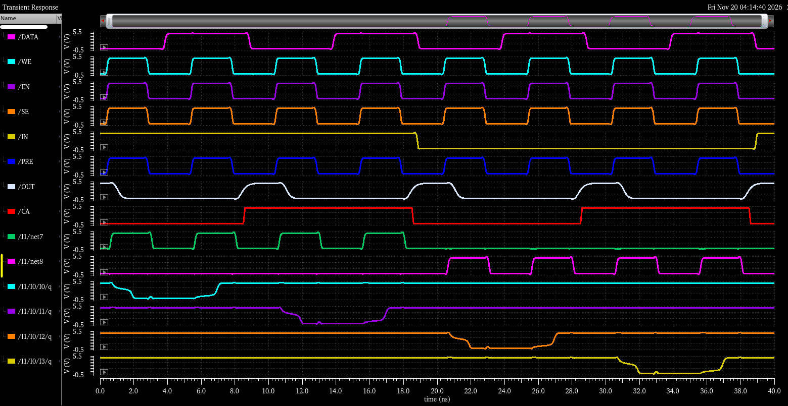

Cell A(0 ~ 10 ns) → B(10 ~ 20 ns) → C(20 ~ 30 ns) → D(30 ~ 40 ns) 순서로, 셀마다 **Write 0 → Write 1**을 수행했습니다. WE · EN · SE · PRE는 5 ns 주기, 폭 약 2.4 ns(50% 기준)의 펄스로 함께 인가됩니다.

### Write Delay

**정의** — Word Line이 50%(2.5 V)를 지나는 시점부터 `q`가 50%에 도달할 때까지 걸리는 시간의 최댓값 (4개 셀 × Write 0/1 중 Worst-case)

셀마다 10 ns 구간 안의 Write 0 · Write 1 지연을 모두 구하고(`?multiple t`) 최댓값(`ymax`)을 취했습니다. B ~ D는 Word Line · 셀 노드 · 측정 구간만 바뀝니다.

```
A_twrite:
ymax(delay(?wf1 clip(VT("/I1/net7") 0 10n) ?value1 2.5 ?edge1 "rising" ?nth1 1 ?td1 0
           ?wf2 clip(VT("/I1/I0/I0/q") 0 10n) ?value2 2.5 ?edge2 "either" ?nth2 1 ?td2 nil
           ?stop nil ?multiple t))
```

| Output | 셀 | Word Line → 셀 노드 | 측정 구간 | Write Delay |
|---|:---:|---|:---:|---:|
| `A_twrite` | A | `net7` → `I0/q` | 0 ~ 10 ns | **1.262 ns** |
| `B_twrite` | B | `net7` → `I1/q` | 10 ~ 20 ns | **1.257 ns** |
| `C_twrite` | C | `net8` → `I2/q` | 20 ~ 30 ns | **1.262 ns** |
| `D_twrite` | D | `net8` → `I3/q` | 30 ~ 40 ns | **1.262 ns** |

Cell A를 전이 방향별로 나눠 보면 **Write 1 (q: 0 → 1) 1.261 ns**, **Write 0 (q: 1 → 0) 1.096 ns**입니다.

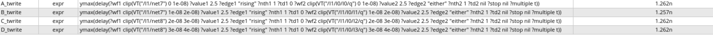

### Read Delay

**정의** — Word Line이 50%(2.5 V)를 지나는 시점부터 `OUT`이 50%에 도달할 때까지 걸리는 시간의 최댓값 (4개 셀 × Read 0/1 중 Worst-case)

Write 파형(0 ~ 40 ns)과 별도의 시뮬레이션에서, 셀마다 Read 0 · Read 1 두 구간의 지연을 각각 구한 뒤 최댓값(`max`)을 취했습니다. `/OUT`은 출력 패드 이후 노드이므로 출력 패드 지연이 포함됩니다.

```
A_tread:
max(delay(?wf1 clip(VT("/I1/net7") 15n 20n) ?value1 2.5 ?edge1 "rising" ?nth1 1 ?td1 0
          ?wf2 clip(VT("/OUT") 15n 20n) ?value2 2.5 ?edge2 "either" ?nth2 1 ?td2 nil
          ?stop nil ?multiple nil)
    delay(?wf1 clip(VT("/I1/net7") 25n 30n) ?value1 2.5 ?edge1 "rising" ?nth1 1 ?td1 0
          ?wf2 clip(VT("/OUT") 25n 30n) ?value2 2.5 ?edge2 "either" ?nth2 1 ?td2 nil
          ?stop nil ?multiple nil))
```

| Output | 셀 | Word Line | 측정 구간 (2회) | Read Delay |
|---|:---:|---|:---:|---:|
| `A_tread` | A | `net7` | 15 ~ 20 ns, 25 ~ 30 ns | **2.829 ns** |
| `B_tread` | B | `net7` | 35 ~ 40 ns, 45 ~ 50 ns | **2.829 ns** |
| `C_tread` | C | `net8` | 55 ~ 60 ns, 65 ~ 70 ns | **2.829 ns** |
| `D_tread` | D | `net8` | 75 ~ 80 ns, 85 ~ 90 ns | **2.829 ns** |

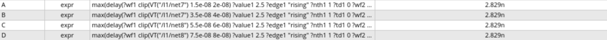

### 에너지 · 전력 측정

VDD 전원 소스 `V1`의 단자 전류로 계산했습니다. 소스가 회로에 전류를 공급하면 `IT("/V1/PLUS")`가 음수가 되므로, −V<sub>DD</sub>(= −5)를 곱해 양수로 바꿉니다.
동작별 에너지는 Cell A에 Write 0 → Read 0 → Write 1 → Read 1을 수행하는 각 구간(10 / 15 / 20 / 25 ns부터)을 적분한 값입니다.

| 항목 | 계산 | Maestro Expression |
|---|---|---|
| 에너지 (`E_wr0` · `E_wr1` · `E_rd0` · `E_rd1`) | −V<sub>DD</sub> · ∫ I<sub>V1</sub> dt (해당 동작 구간) | `-5 * integ(IT("/V1/PLUS") t1 t2)` |
| 전력 (`P_avg` · `P_leak`) | −V<sub>DD</sub> · avg(I<sub>V1</sub>) (동작 구간 / 대기 구간) | `-5 * average(clip(IT("/V1/PLUS") t1 t2))` |
| 피크 전류 (`I_peak`) | max(−I<sub>V1</sub>) (전체 구간) | `ymax((- IT("/V1/PLUS")))` |

<p>
  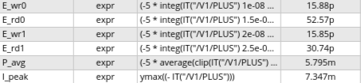
</p>
<p>
  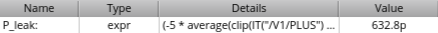
</p>

### 분석

- **Write Delay** — 4개 셀이 1.257 ~ 1.262 ns로 편차 5 ps 이내 → 셀 위치(Row / Column)에 따른 차이가 거의 없음. Cell A 기준 Write 1(0 → 1)이 Write 0(1 → 0)보다 약 0.17 ns 느려 Worst-case를 결정
- **Read Delay** — 4개 셀 모두 2.829 ns로 동일 (출력 패드 지연 포함)
- **Write 에너지** — '0' 15.88 pJ, '1' 15.85 pJ로 데이터 값과 관계없이 거의 같음
- **Read 에너지** — Read 0(52.57 pJ)이 Read 1(30.74 pJ)의 약 1.7배이며, 둘 다 Write보다 큼
- **누설 전력** — 632.8 pW로 평균 전력(5.795 mW)의 약 10⁻⁷ 수준
- **데이터 유지** — 같은 Word Line을 쓰는 비선택 셀(예: Cell A에 쓰는 동안의 Cell B)과 이미 기록된 셀의 `q`가 이후 Write 동안 그대로 유지됨

---

## ✅ 물리 검증 (DRC / LVS)

Siemens **Calibre 2023.3**으로 검증했습니다.

| DRC | LVS |
|:---:|:---:|
|  | 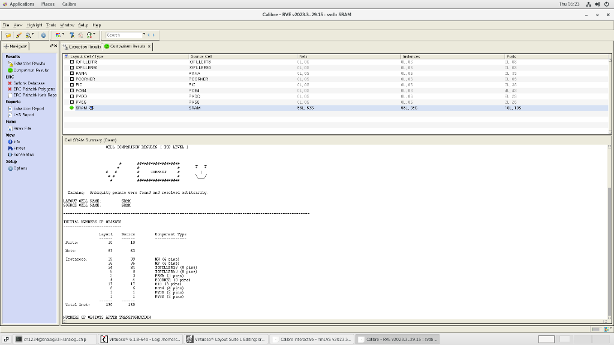 |
| DRC Clean | **CORRECT** — Layout/Source 인스턴스 130 / 130 일치 |

---

## 📍 핀 배치

28-pin SOP 패키지 (MPW_PAD_28pin 표준 배치)

| 신호 | 핀 | 설명 | | 신호 | 핀 | 설명 |
|---|:---:|---|---|---|:---:|---|
| OUT | 5 | 테스트 Inverter 출력 | | RIN | 18 | Row 주소 입력 |
| PRE | 6 | Precharge 제어 | | WE | 19 | Write Enable |
| IN | 11 | 테스트 Inverter 입력 | | SAE | 20 | Sense Amp Enable |
| DATA | 12 | 쓰기 데이터 입력 | | CA | 24 | Column 주소 입력 |
| VDD | 14 | 전원 | | OUTS | 26 | SRAM 데이터 출력 |
| REN | 15 | Row Decoder Enable | | VSS | 28 | 접지 |

---

## 🔬 실리콘 검증 계획

제작된 칩을 Breakout Board를 통해 **AMD Zynq-7000 SoC** 보드에 연결하고, FPGA BRAM 기반 레퍼런스 SRAM과 동작을 비교합니다. 실측한 Delay · Power는 [성능 측정](#-성능-측정-simulation)의 시뮬레이션 기준값과 비교합니다.

```
 PC ──UART──▶ Zynq PS (ARM Cortex-A9, Vitis)
                    │ AMBA (AXI)
                    ▼
             Zynq PL (Verilog, Vivado)
             ├─ Reference SRAM (BRAM)
             └─ Test Sequencer ──▶ Breakout Board ──▶ Silicon SRAM Chip
                                                         │
                                               Oscilloscope (SAE / OUTS)
```

| 단계 | 검증 항목 | 판정 기준 |
|:---:|---|---|
| 0 | 테스트 Inverter | 패키징 및 기본 공정 건전성 확인 |
| 1 | Precharge 회로 | DATA '1' 기록 → PRE High → PRE Low 후 연속 Read 시 비트라인 전압 유지 여부 (구동력 부족·누설 전류 판별) |
| 2 | Row Decoder / Column MUX | 특정 주소 전체 R/W 불가 → 소자 결함, 다중 주소 활성화 → Double Selection 결함 |
| 3 | Write Driver | 4개 셀 전체 '1' / '0' 쓰기 후 읽기 → 쓰기 시에만 오류 시 드라이버 구동력 결함 |
| 4 | Read 타이밍 | 오실로스코프로 SAE → OUTS 지연(Read Access Time), Slew Rate, 펄스 응답 측정 |

---

## 🛠 개발 환경

| 용도 | Tool |
|---|---|
| Schematic / Simulation | Cadence Virtuoso 6.1.8 (ADE Explorer, ADE XL / Maestro) |
| Layout | Cadence Virtuoso Layout Suite 6.1.8 |
| DRC / LVS | Siemens Calibre 2023.3 |
| 실리콘 검증 (예정) | AMD Vivado, Vitis, Zynq-7000 |

---

## 📁 저장소 구조

```
MYCHIP_6T-SRAM/
├── README.md
└── docs/
    └── images/
        ├── schematic/      # 블록별 회로도
        ├── layout/         # 블록별 레이아웃 + 패드 포함 칩
        ├── simulation/     # Testbench, Transient 파형, 성능 측정 캡처
        └── verification/   # DRC / LVS 결과
```

---

## 👥 팀

한성대학교 학부연구생 칩 설계 프로젝트

| 이름 | 소속 |
|---|---|
| 홍원기 | 한성대학교 시스템반도체트랙 |
| 김경일 | 한성대학교 시스템반도체트랙 |
| 이종복 | 한성대학교 전자트랙 교수 |

## 🙏 Acknowledgement

본 프로젝트는 과학기술정보통신부 **반도체설계검증인프라활성화사업** (No. RS-2023-00258732)의 지원과 모아팹(MoaFab) 'MyChip' 서비스를 통해 수행되었습니다.
